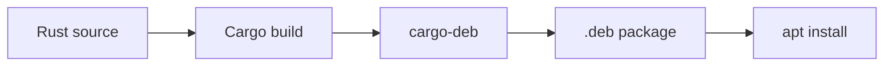

# From source to DEB

## By the end, you will be able to

- Build a Rust release binary with Cargo.
- Package it as a Debian `.deb` file.
- Install and remove the package on Debian or Ubuntu.

---

## The workflow

`cargo-deb` reads your Cargo project, builds the release binary, and places it
inside a Debian package with metadata from `Cargo.toml`.



This lesson assumes a binary Cargo project with a `Cargo.toml` file and a
`src/main.rs` entry point.

## 1. Prepare the project

From the project root, check, format, lint, and test before packaging:

```bash
cargo fmt -- --check
cargo clippy --all-targets --all-features -- -D warnings
cargo test
cargo build --release
```

The release binary is written to `target/release/<binary-name>`.

## 2. Install the Debian packager

Install the Cargo subcommand once:

```bash
cargo install cargo-deb
```

If installation reports that Rust is too old, update the Rust toolchain first:

```bash
rustup update
```

## 3. Add package metadata

A basic binary can be packaged without extra configuration. Add metadata when
you want a maintainer, section, or explicit runtime dependencies:

```toml
[package.metadata.deb]
maintainer = "Your Name <you@example.com>"
section = "utils"
priority = "optional"
depends = "$auto"
```

The package name and version come from the `[package]` section:

```toml
[package]
name = "hello-rust"
version = "0.1.0"
```

## 4. Create the `.deb` file

Run this from the directory containing `Cargo.toml`:

```bash
cargo deb
```

The result is written to `target/debian/`. Its filename contains the package
name, version, Debian revision, and architecture, for example:

```text
target/debian/hello-rust_0.1.0-1_amd64.deb
```

To package the course Hello World project from the repository root:

```bash
cargo deb \
  --manifest-path examples/00-first-lesson/hello-world/Cargo.toml
```

## 5. Inspect and install it

Inspect the archive before installing it:

```bash
dpkg-deb --info target/debian/hello-rust_*.deb
dpkg-deb --contents target/debian/hello-rust_*.deb
```

Install it locally with `apt`, which can resolve package dependencies:

```bash
sudo apt install ./target/debian/hello-rust_*.deb
```

Run the installed program:

```bash
hello-rust
```

Remove it later with:

```bash
sudo apt remove hello-rust
```

## Architecture matters

A `.deb` is built for a target architecture. Check the architecture of the
current machine with:

```bash
dpkg --print-architecture
```

For a specific Rust target, install the target toolchain and pass it to
`cargo-deb`:

```bash
rustup target add x86_64-unknown-linux-gnu
cargo deb --target x86_64-unknown-linux-gnu
```

Cross-compilation may also require a linker and system libraries for the target
architecture.

---

## Checkpoint

<div class="quiz" data-answer="b">
<p>Which command creates the Debian package?</p>
<label><input type="radio" name="deb-command" value="a"> <code>cargo publish</code></label><br>
<label><input type="radio" name="deb-command" value="b"> <code>cargo deb</code></label><br>
<label><input type="radio" name="deb-command" value="c"> <code>rustc --deb</code></label><br>
<button class="quiz-check">Check answer</button>
<p class="quiz-result"></p>
</div>

## Summary

The repeatable release path is:

```bash
cargo fmt -- --check
cargo clippy --all-targets --all-features -- -D warnings
cargo test
cargo deb
sudo apt install ./target/debian/*.deb
```
