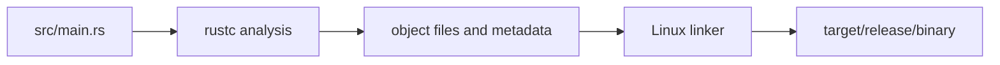

# Linux compiler output

## By the end, you will be able to

- Find the important files produced by Cargo on Linux.
- Tell debug output from release output.
- Inspect a Rust executable with standard Linux tools.

---

## A small demo project

The demo contains one binary and one library target:

```text
linux-compiler-output/
├── Cargo.toml
└── src/
    ├── lib.rs
    └── main.rs
```

Cargo discovers `src/main.rs` as the executable target and `src/lib.rs` as the
library target.

Build it from the repository root:

```bash
cargo build --manifest-path examples/00-first-lesson/linux-compiler-output/Cargo.toml
cargo build --manifest-path examples/00-first-lesson/linux-compiler-output/Cargo.toml --release
```

Run it:

```bash
cargo run --manifest-path examples/00-first-lesson/linux-compiler-output/Cargo.toml
```

Expected output:

```text
Hello from a Linux Rust binary
2 + 3 = 5
```

## What Cargo creates

Cargo puts compiler output in `target/` by default. The profile directory
separates normal development builds from optimized release builds:

| Path | Meaning |
| --- | --- |
| `target/debug/` | Development build with fast compilation and debug information. |
| `target/release/` | Optimized build intended for distribution. |
| `target/debug/<name>` | Debug executable. |
| `target/release/<name>` | Release executable. |
| `target/debug/deps/` | Dependency and intermediate artifacts. |
| `target/debug/incremental/` | Incremental compiler cache. |
| `target/doc/` | Output from `cargo doc`. |
| `target/package/` | Output from `cargo package`. |

The exact contents of `deps/`, `incremental/`, and build-script directories are
compiler internals. Do not copy them to a target machine.

## Common file types

| File | Meaning |
| --- | --- |
| No extension on Linux | Usually an executable binary. |
| `.rlib` | Rust library artifact used by the Rust compiler. |
| `.rmeta` | Rust metadata used during compilation. |
| `.so` | Dynamic shared library on Linux. |
| `.d` | Dependency information used to know when to rebuild. |
| `.o` | Object file used before final linking. |

For normal application deployment, copy only the release executable or the
final library package. The `.rlib`, `.rmeta`, `.d`, and `.o` files are not
application deliverables.

## `check` versus `build`

```bash
cargo check --manifest-path examples/00-first-lesson/linux-compiler-output/Cargo.toml
cargo build --manifest-path examples/00-first-lesson/linux-compiler-output/Cargo.toml
```

`cargo check` runs the compiler's analysis without producing a final linked
executable. It is fast and useful while editing. `cargo build` continues to
link the final binary into `target/debug/`.

## Inspect the Linux executable

Use `find` to locate final binaries:

```bash
find examples/00-first-lesson/linux-compiler-output/target \
  -maxdepth 3 -type f -executable -print
```

Use `file` to identify the binary format and architecture:

```bash
file examples/00-first-lesson/linux-compiler-output/target/release/linux-compiler-output
```

On a typical 64-bit Linux host, the output includes `ELF 64-bit` and the
machine architecture.

Use `ldd` to view dynamically linked system libraries:

```bash
ldd examples/00-first-lesson/linux-compiler-output/target/release/linux-compiler-output
```

Use `readelf` to inspect the ELF header without executing the program:

```bash
readelf -h examples/00-first-lesson/linux-compiler-output/target/release/linux-compiler-output
```

These commands inspect the final executable. They do not replace `cargo build`
and should not be used to edit compiler output.

## The compiler pipeline



Cargo coordinates the process, `rustc` compiles Rust code, and the Linux linker
combines object files and libraries into the final ELF executable.

## Clean and rebuild

```bash
cargo clean --manifest-path examples/00-first-lesson/linux-compiler-output/Cargo.toml
cargo build --manifest-path examples/00-first-lesson/linux-compiler-output/Cargo.toml --release
```

`cargo clean` removes generated build artifacts. It does not remove source
files or `Cargo.toml`.

---

## Checkpoint

<div class="quiz" data-answer="b">
<p>Where does <code>cargo build --release</code> place the final binary?</p>
<label><input type="radio" name="linux-output-path" value="a"> <code>target/debug/</code></label><br>
<label><input type="radio" name="linux-output-path" value="b"> <code>target/release/</code></label><br>
<label><input type="radio" name="linux-output-path" value="c"> <code>src/release/</code></label><br>
<button class="quiz-check">Check answer</button>
<p class="quiz-result"></p>
</div>
