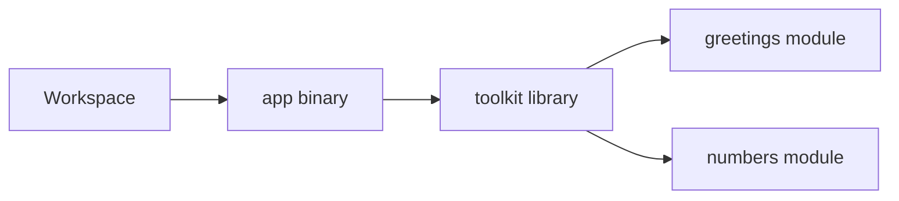

# Cargo workspace with a binary and library

## By the end, you will be able to

- Create a workspace containing an executable and a library package.
- Split library code into two modules.
- Import and call library functions from the executable.

---

## Workspace layout

A workspace groups related Cargo packages under one root manifest. In this
example, `app` is the executable and `toolkit` is the library:

```text
cargo-workspace/
├── Cargo.toml
├── app/
│   ├── Cargo.toml
│   └── src/main.rs
└── toolkit/
    ├── Cargo.toml
    └── src/
        ├── lib.rs
        ├── greetings.rs
        └── numbers.rs
```

The root `Cargo.toml` lists both packages:

```toml
[workspace]
members = ["app", "toolkit"]
resolver = "2"
```

The workspace root does not need its own `src/` directory.

## The library package

`toolkit/Cargo.toml` identifies the library package:

```toml
[package]
name = "toolkit"
version = "0.1.0"
edition = "2024"
```

Declare the two modules in `toolkit/src/lib.rs` and re-export their public
functions:

```rust
pub mod greetings;
pub mod numbers;
```

The first module, `toolkit/src/greetings.rs`, contains a greeting function:

```rust
pub fn hello(name: &str) -> String {
    format!("Hello, {name}!")
}
```

The second module, `toolkit/src/numbers.rs`, contains a calculation:

```rust
pub fn add(left: i32, right: i32) -> i32 {
    left + right
}
```

`pub` makes the modules and functions available outside the library crate.

## The executable package

Declare the library as a path dependency in `app/Cargo.toml`:

```toml
[package]
name = "app"
version = "0.1.0"
edition = "2024"

[dependencies]
toolkit = { path = "../toolkit" }
```

The executable imports both modules and calls one function from each:

```rust
use toolkit::{greetings, numbers};

fn main() {
    println!("{}", greetings::hello("workspace"));
    println!("2 + 3 = {}", numbers::add(2, 3));
}
```

Expected output:

```text
Hello, workspace!
2 + 3 = 5
```

The dependency graph is:



## Build and run the workspace

Run these commands from the workspace root:

```bash
cargo check
cargo test
cargo run -p app
cargo build --release -p app
```

Cargo builds the library before linking the executable. The release executable
is written to `target/release/app` on Linux.

You can also run the package by manifest path from the repository root:

```bash
cargo run --manifest-path examples/00-first-lesson/cargo-workspace/app/Cargo.toml
```

Cargo finds the workspace root by following the package's parent directories.

## Tests belong next to the code they verify

The demo puts unit tests in the library modules:

```rust
#[cfg(test)]
mod tests {
    use super::add;

    #[test]
    fn adds_two_numbers() {
        assert_eq!(add(2, 3), 5);
    }
}
```

Run all workspace tests with:

```bash
cargo test
```

---

## Checkpoint

<div class="quiz" data-answer="c">
<p>How does the executable use the local library package?</p>
<label><input type="radio" name="workspace-dependency" value="a"> By copying <code>lib.rs</code> into <code>main.rs</code></label><br>
<label><input type="radio" name="workspace-dependency" value="b"> By publishing the library first</label><br>
<label><input type="radio" name="workspace-dependency" value="c"> By declaring a path dependency in <code>app/Cargo.toml</code></label><br>
<button class="quiz-check">Check answer</button>
<p class="quiz-result"></p>
</div>
