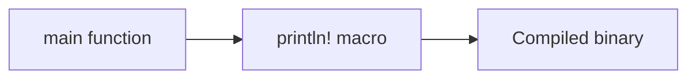

# Module 0: Hello, Rust

## By the end, you will be able to

- Explain what a Rust binary starts with.
- Compile and run a minimal Rust program.
- Make a small edit and predict its output.

---

## Intuition

Rust programs start at a function named `main`. The `println!` macro writes a
line of text to the terminal. Rust checks the program before running it, so
mistakes are reported early by the compiler.



---

## Try it

```bash
rustc examples/00-first-lesson/main.rs -o /tmp/rust-hello
/tmp/rust-hello
```

Expected output:

```text
Hello, Rust!
```

## Exercise

Change the message in `main.rs`, compile again, and predict the new output.

## Review

1. Which function is the entry point of a Rust binary?
2. What does `println!` produce?
3. Why does Rust compile the source before running it?
