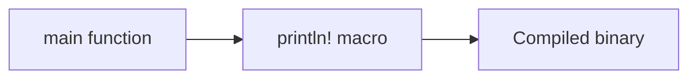

# Module 0: Set up Rust and build Hello World

## By the end, you will be able to

- Install the stable Rust toolchain with `rustup`.
- Explain the jobs of `rustup`, `rustc`, and Cargo.
- Build, run, format, check, and package a small application.

---

## Intuition

Rust programs start at a function named `main`. The `println!` macro writes a
line of text to the terminal. Rust checks the program before running it, so
mistakes are reported early by the compiler.



---

## Install the toolchain

The recommended installer is `rustup`. On Linux, macOS, or WSL, run:

```bash
curl --proto '=https' --tlsv1.2 -sSf https://sh.rustup.rs | sh
```

Accept the default stable toolchain, then open a new terminal so the Cargo bin
directory is on your `PATH`. On Windows, download and run `rustup-init.exe`
from the [official installation page](https://rust-lang.org/tools/install/).
Windows builds may also need the Visual Studio C++ build tools.

Verify the installation:

```bash
rustup show
rustc --version
cargo --version
```

Keep the stable toolchain current with `rustup update`. If a command is not
found after installation, restart the terminal and check that
`$HOME/.cargo/bin` is on `PATH`.

## The important commands

| Command | Job |
| --- | --- |
| `rustup` | Installs and selects Rust toolchains and components. |
| `rustc` | Compiles a Rust source file directly. |
| `cargo` | Creates, builds, runs, tests, documents, and packages projects. |
| `rustfmt` | Formats Rust source consistently. |
| `clippy` | Finds common mistakes and non-idiomatic Rust. |
| `rustdoc` | Generates API documentation from Rust comments. |
| `rust-analyzer` | Gives editor features such as completion and diagnostics. |

The standard stable installation includes Cargo, `rustfmt`, and Clippy. If a
component is missing, install it explicitly:

```bash
rustup component add rustfmt clippy
rustup component add rust-src  # useful for rust-analyzer
```

Most editors install or bundle `rust-analyzer`; VS Code uses the official
extension. The compiler tools work independently of any editor.

## Create a Hello World application

Cargo keeps the source layout and build metadata together. From the repository
root, create a new application in a temporary directory:

```bash
cargo new /tmp/hello-rust
cd /tmp/hello-rust
```

Cargo creates `Cargo.toml` and `src/main.rs`. Replace `src/main.rs` with:

```rust
fn main() {
    println!("Hello, Rust!");
}
```

## Build, run, and package it

Run these commands inside `/tmp/hello-rust`:

```bash
cargo check                 # type-check quickly without creating a binary
cargo build                 # debug build in target/debug/
cargo run                   # build if needed, then run the binary
cargo run -- Rust           # pass Rust as an argument to the binary
cargo build --release       # optimized build in target/release/
cargo test                  # run tests, when the project has tests
cargo doc --open            # build and open local API documentation
cargo package --allow-dirty # validate the package archive locally
```

For this application, the release binary is `target/release/hello-rust` on
Linux and macOS, or `target/release/hello-rust.exe` on Windows. `cargo package`
creates a crate archive for distribution and checks that the package can be
published. It does not upload anything. Use `cargo publish` only when you
intend to publish a crate to crates.io.

## Format and lint before sharing

```bash
cargo fmt                 # format the whole project
cargo fmt -- --check      # fail if formatting would change files
cargo clippy --all-targets --all-features -- -D warnings
```

`rustfmt` handles layout. Clippy provides advice about correctness,
performance, and idiomatic style. Treat warnings as errors in CI when the
project is ready for that policy.

The commands above are the standard Rust workflow: check, format, lint, test,
build, then create a release artifact.

## Run the course example

The repository also contains a Cargo version of Hello World:

```bash
cargo run --manifest-path examples/00-first-lesson/hello-world/Cargo.toml
```

Expected output:

```text
Hello, Rust!
```

## Exercise

Change the message in `examples/00-first-lesson/hello-world/src/main.rs`, run
`cargo fmt`, and use `cargo run --manifest-path
examples/00-first-lesson/hello-world/Cargo.toml` to see the result.

## Review

1. Which command manages Rust toolchains?
2. Which command runs the current Cargo package?
3. Which command formats Rust source code?
