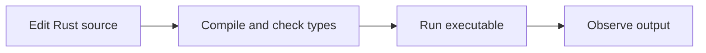

# Topic 1: Fundamentals overview

By the end, you will be able to

- Describe the edit, compile, and run cycle.
- Run and change a small Rust program.
- Follow the module learning path toward a tested number summary.

Prerequisite: [Module 0 setup and Hello World](../00-first-lesson/index.md).

---

## From source to a running program

Rust source describes the steps a program should perform. The compiler checks
that source and creates an executable; running the executable performs those
steps. Cargo automates the build and run workflow for projects.


<div class="quiz" data-answer="a" data-explanation="A compiler error prevents a successful build of the changed program.">
<p>When does a compiler type error need to be fixed?</p>
<label><input type="radio" name="fundamentals-t1-q1" value="a"> Before an executable can be built successfully</label><br>
<label><input type="radio" name="fundamentals-t1-q1" value="b"> Only after the executable exits</label><br>
<label><input type="radio" name="fundamentals-t1-q1" value="c"> Only when writing tests</label><br>
<button class="quiz-check">Check answer</button>
<p class="quiz-result" aria-live="polite"></p>
</div>

---

## A small runnable program

`main` is the entry point. `println!` writes a line to the terminal; the
exclamation mark identifies a macro. The double-quoted text is a string literal.

```rust
--8<-- "examples/01-fundamentals/01-fundamentals-overview/main.rs"
```

Run from the repository root:

```bash
rustc examples/01-fundamentals/01-fundamentals-overview/main.rs -o /tmp/rust-fundamentals-intro
/tmp/rust-fundamentals-intro
```

Expected output: `Hello, fundamentals!`.
<div class="quiz" data-answer="b" data-explanation="Rust starts this executable by calling main.">
<p>Which part begins execution in this program?</p>
<label><input type="radio" name="fundamentals-t1-q2" value="a"> The filename</label><br>
<label><input type="radio" name="fundamentals-t1-q2" value="b"> <code>main</code></label><br>
<label><input type="radio" name="fundamentals-t1-q2" value="c"> The quoted text</label><br>
<button class="quiz-check">Check answer</button>
<p class="quiz-result" aria-live="polite"></p>
</div>

---

## Learning path and exercise

- Topics 2–4 introduce bindings, types, collections, and text.
- Topics 5–7 add functions, decisions, patterns, and repetition.
- Topic 8 combines them in the tested number-summary Cargo project.

Change the greeting to include your name. Predict the output, compile again,
and run. Then remove the closing quote, read the diagnostic, and restore it.
Detailed ownership rules come in Module 2; this module first builds the syntax
and workflow needed to understand those rules.

## Check your understanding
<div class="quiz" data-answer="c" data-explanation="Recompilation makes the executable reflect the source change.">
<p>How should you check a source change?</p>
<label><input type="radio" name="fundamentals-t1-q3" value="a"> Run only the old executable</label><br>
<label><input type="radio" name="fundamentals-t1-q3" value="b"> Skip compilation when the change looks simple</label><br>
<label><input type="radio" name="fundamentals-t1-q3" value="c"> Compile the changed source, then run the resulting executable</label><br>
<button class="quiz-check">Check answer</button>
<p class="quiz-result" aria-live="polite"></p>
</div>

---

## Next

Continue with [Topic 2: Variables, mutability, and shadowing](02-variables-mutability-shadowing.md). Return to the [topic index](index.md).
