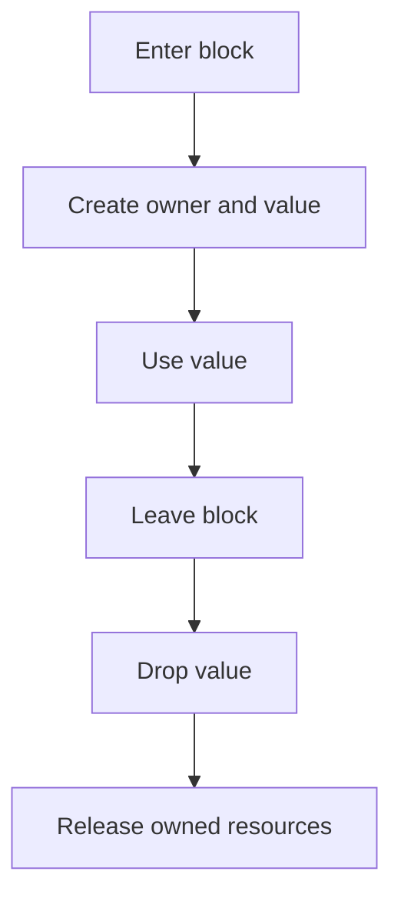
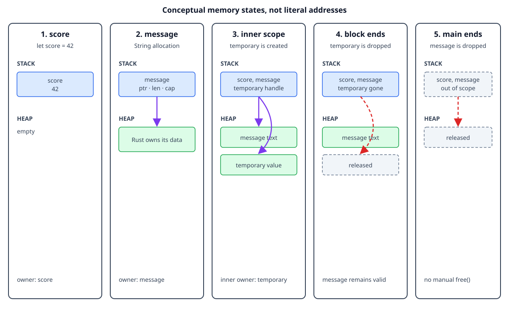

# Values, variables, and scope

## By the end, you will be able to

- Distinguish a value from the variable that owns it.
- Explain the difference between stack and heap storage at a high level.
- Predict when a variable leaves scope and its value is dropped.

---

## Values and variables

A **value** is data such as `42` or the text stored in a `String`. A **variable**
is a name that lets the program use a value:

```rust
let score = 42;
```

Here, `42` is the value and `score` is the variable that owns it. By default,
variables are immutable, so use `let mut` when the binding itself must change:

```rust
let mut score = 42;
score = 43;
```

## Scope

Scope is the part of the program where a variable is valid. A variable starts
when its `let` statement runs and ends at the closing brace of its block.

```rust
fn main() {
    let outside = "available here";

    {
        let inside = "available only in this block";
        println!("{outside}, {inside}");
    }

    println!("{outside}");
    // println!("{inside}"); // would fail: `inside` is out of scope
}
```

Rust drops a value when its owner leaves scope. For a small stack value, this
usually means the storage is no longer needed. For a heap-backed value such as
`String` or `Vec<T>`, Rust also releases the heap allocation automatically.



## Stack and heap, briefly

The **stack** is fast storage for values with a known, simple layout, such as
integers. The **heap** stores data whose size can change or whose ownership must
outlive a single expression. A `String` value keeps a small handle on the stack
and its text in a heap allocation.

The important ownership lesson is that the variable still owns the complete
`String`, including the heap data. When the variable leaves scope, Rust cleans
up the allocation without a manual `free` call.

The same rule applies to `Vec<T>`. A vector stores its elements in a heap
allocation, while the `Vec` handle on the stack tracks the allocation. The
variable owns both the handle and the elements it contains:

```rust
{
    let mut numbers = vec![1, 2, 3];
    numbers.push(4);
    println!("numbers: {numbers:?}");
} // numbers and its heap allocation are dropped here
```

Expected output:

```text
numbers: [1, 2, 3, 4]
```

The vector is automatically cleaned up when the block ends. No manual
deallocation is needed.

## Why heap-backed types matter

Real programs often need data whose size is known only while the program is
running: user input, a file, a network response, or a collection of records.
`String`, `Vec<T>`, and similar types keep that changing data on the heap while
their small ownership handle stays on the stack.

That extra allocation is useful because the data can grow, but it also creates
resources that must have one clear owner. Rust's ownership rules make sure the
allocation is released exactly once and cannot be used after its owner has
gone away. Borrowing then lets another function temporarily read or modify the
data without taking ownership:

```rust
fn add_label(labels: &mut Vec<String>) {
    labels.push(String::from("Rust"));
}

fn main() {
    let mut labels = vec![String::from("safe")];
    add_label(&mut labels); // borrowed temporarily, then returned to `labels`
    println!("{labels:?}");
} // `labels` owns the vector and its strings until cleanup
```

Expected output:

```text
["safe", "Rust"]
```

This is why heap-backed types are central to ownership and borrowing: they let
Rust support flexible, useful data structures without requiring manual
`free`, while still making the lifetime and access rules explicit.

## Complete runnable example

The lesson displays the same source file that you can compile from the matching
`examples/` directory. Keeping one source file prevents the lesson and demo
from drifting apart.

```rust
--8<-- "examples/02-ownership-and-borrowing/01-values-variables-scope/main.rs"
```

## Memory after each step

The diagrams below are conceptual. They explain ownership and lifetime, not
literal addresses, stack offsets, allocator metadata, or an exact compiler
layout.



### Step 1: create `score`

```rust
let score = 42;
```

| Area | State |
| --- | --- |
| Stack | `score` owns the integer value `42`. |
| Heap | No allocation is needed for this integer. |
| Scope | `score` is valid until the end of `main`. |

### Step 2: create `message`

```rust
let message = String::from("Rust owns its data");
```

| Area | State |
| --- | --- |
| Stack | `message` owns a `String` handle containing a pointer, length, and capacity. |
| Heap | The string characters are stored in an allocation owned by `message`. |
| Scope | `message` is valid until the end of `main`. |

### Step 3: enter the inner scope

```rust
{
    let temporary = String::from("temporary value");
}
```

| Area | State |
| --- | --- |
| Stack | `score`, `message`, and `temporary` are valid in the inner block. |
| Heap | There are separate allocations for `message` and `temporary`. |
| Scope | `temporary` is valid only inside the inner block. |

### Step 4: leave the inner scope

When the closing brace runs, `temporary` leaves scope first:

| Area | State |
| --- | --- |
| Stack | The `temporary` binding is gone. `score` and `message` remain. |
| Heap | The allocation owned by `temporary` is released. `message` remains allocated. |
| Scope | Code after the block can still use `score` and `message`. |

### Step 5: leave `main`

At the end of `main`, Rust drops the remaining owners automatically:

| Area | State |
| --- | --- |
| Stack | `score` and the `message` handle leave scope. |
| Heap | The allocation owned by `message` is released. |
| Result | No manual `free` call is needed. |

## Try it

The demo creates a stack integer, a heap-backed `String`, and an inner scope.

```bash
rustc examples/02-ownership-and-borrowing/01-values-variables-scope/main.rs \
  -o /tmp/rust-scope-demo
/tmp/rust-scope-demo
```

Expected output:

```text
score: 42
message: Rust owns its data
inside: temporary value
outside: still in scope
```

## Exercise

1. Change `score` to `let mut score = 42` and update it to `43`.
2. Move `message` into the inner block and see which line stops compiling.
3. Restore the program and add a second `String` inside the inner block.

---

## Checkpoint 1

<div class="quiz" data-answer="a">
<p>What is the scope of a variable?</p>
<label><input type="radio" name="scope-definition" value="a"> The region where the variable is valid</label><br>
<label><input type="radio" name="scope-definition" value="b"> The entire program</label><br>
<label><input type="radio" name="scope-definition" value="c"> Only the line where it is declared</label><br>
<button class="quiz-check">Check answer</button>
<p class="quiz-result"></p>
</div>

## Checkpoint 2

<div class="quiz" data-answer="c">
<p>What happens when an owner leaves its scope?</p>
<label><input type="radio" name="scope-drop" value="a"> The value becomes global</label><br>
<label><input type="radio" name="scope-drop" value="b"> Rust copies the value forever</label><br>
<label><input type="radio" name="scope-drop" value="c"> Rust drops the value and releases its resources</label><br>
<button class="quiz-check">Check answer</button>
<p class="quiz-result"></p>
</div>

## Checkpoint 3

<div class="quiz" data-answer="b">
<p>Where are the elements of a growing <code>Vec&lt;T&gt;</code> usually stored?</p>
<label><input type="radio" name="vec-storage" value="a"> Only inside the source code</label><br>
<label><input type="radio" name="vec-storage" value="b"> In a heap allocation owned by the vector</label><br>
<label><input type="radio" name="vec-storage" value="c"> In a global variable shared by every vector</label><br>
<button class="quiz-check">Check answer</button>
<p class="quiz-result"></p>
</div>

## Checkpoint 4

<div class="quiz" data-answer="a">
<p>What does <code>numbers.push(4)</code> do in the example?</p>
<label><input type="radio" name="vec-push" value="a"> It adds <code>4</code> to the vector</label><br>
<label><input type="radio" name="vec-push" value="b"> It transfers the vector to another owner</label><br>
<label><input type="radio" name="vec-push" value="c"> It deletes the vector's existing elements</label><br>
<button class="quiz-check">Check answer</button>
<p class="quiz-result"></p>
</div>

## Next

Continue with [move semantics](index.md#2-move-semantics), where assignment and
function calls can transfer ownership of heap-backed values.
