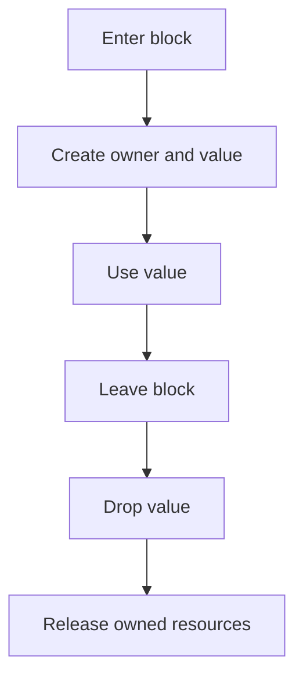

# Values, variables, and scope

## By the end, you will be able to

- Distinguish a value from the variable that owns it.
- Explain the difference between stack and heap storage at a high level.
- Predict when a variable leaves scope and its value is dropped.

---

## Values and variables

A **value** is data such as `42` or the text stored in a `String`. A **variable**
is a name that lets the program use a value:

```rust
let score = 42;
```

Here, `42` is the value and `score` is the variable that owns it. By default,
variables are immutable, so use `let mut` when the binding itself must change:

```rust
let mut score = 42;
score = 43;
```

## Scope

Scope is the part of the program where a variable is valid. A variable starts
when its `let` statement runs and ends at the closing brace of its block.

```rust
fn main() {
    let outside = "available here";

    {
        let inside = "available only in this block";
        println!("{outside}, {inside}");
    }

    println!("{outside}");
    // println!("{inside}"); // would fail: `inside` is out of scope
}
```

Rust drops a value when its owner leaves scope. For a small stack value, this
usually means the storage is no longer needed. For a heap-backed value such as
`String` or `Vec<T>`, Rust also releases the heap allocation automatically.



## Stack and heap, briefly

The **stack** is fast storage for values with a known, simple layout, such as
integers. The **heap** stores data whose size can change or whose ownership must
outlive a single expression. A `String` value keeps a small handle on the stack
and its text in a heap allocation.

The important ownership lesson is that the variable still owns the complete
`String`, including the heap data. When the variable leaves scope, Rust cleans
up the allocation without a manual `free` call.

## Try it

The demo creates a stack integer, a heap-backed `String`, and an inner scope.

```bash
rustc examples/02-ownership-and-borrowing/01-values-variables-scope/main.rs \
  -o /tmp/rust-scope-demo
/tmp/rust-scope-demo
```

Expected output:

```text
score: 42
message: Rust owns its data
inside: temporary value
outside: still in scope
```

## Exercise

1. Change `score` to `let mut score = 42` and update it to `43`.
2. Move `message` into the inner block and see which line stops compiling.
3. Restore the program and add a second `String` inside the inner block.

---

## Checkpoint 1

<div class="quiz" data-answer="a">
<p>What is the scope of a variable?</p>
<label><input type="radio" name="scope-definition" value="a"> The region where the variable is valid</label><br>
<label><input type="radio" name="scope-definition" value="b"> The entire program</label><br>
<label><input type="radio" name="scope-definition" value="c"> Only the line where it is declared</label><br>
<button class="quiz-check">Check answer</button>
<p class="quiz-result"></p>
</div>

## Checkpoint 2

<div class="quiz" data-answer="c">
<p>What happens when an owner leaves its scope?</p>
<label><input type="radio" name="scope-drop" value="a"> The value becomes global</label><br>
<label><input type="radio" name="scope-drop" value="b"> Rust copies the value forever</label><br>
<label><input type="radio" name="scope-drop" value="c"> Rust drops the value and releases its resources</label><br>
<button class="quiz-check">Check answer</button>
<p class="quiz-result"></p>
</div>

## Next

Continue with [move semantics](index.md#2-move-semantics), where assignment and
function calls can transfer ownership of heap-backed values.
