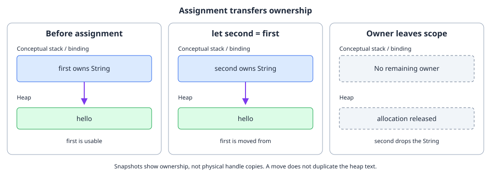
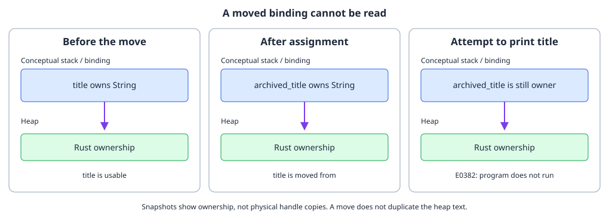
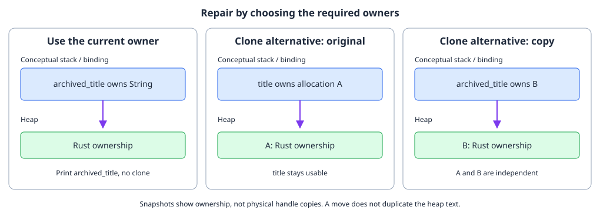
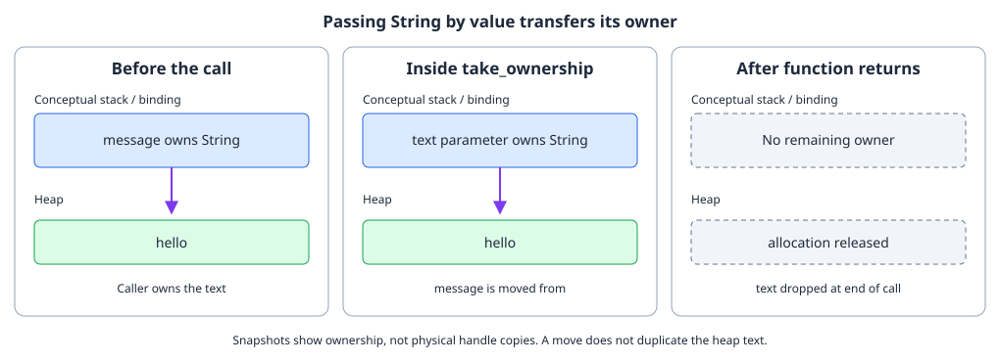
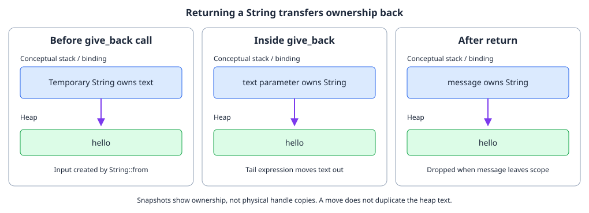

# Move semantics

By the end, you will be able to

- Predict **[moves during assignment](#the-intuition-one-owner-one-cleanup)** for owned strings.
- Explain why a **[moved-from binding](#the-intuition-one-owner-one-cleanup)** cannot be used.
- Trace **[ownership into functions](#moving-into-functions)** and **[returned ownership](#returning-ownership)**.
- Interpret a **[moved-value diagnostic](#compiler-errors-are-ownership-feedback)**.

Prerequisite: [Topic 1: Values, variables, and scope](01-values-variables-scope.md).
Read each code-reading exercise before checking an answer. Snippets with local
bindings belong inside `main`; helper functions belong at module scope. The
complete runnable example includes all required definitions.

---

## The intuition: one owner, one cleanup

For a heap-backed value such as `String`, the variable contains a small handle
that points to data on the heap. If assignment left two independent owners of that same allocation,
two variables could try to release the same allocation. Rust avoids that
problem by moving ownership: the destination becomes the owner and the source
binding is no longer usable.

### Code-reading exercise 1: trace the assignment

Predict which binding remains usable after the assignment.

```rust
let first = String::from("hello");
let second = first; // ownership moves from `first` to `second`
println!("{second}");
```

### Check your prediction

<div class="quiz" data-answer="b" data-explanation="The destination becomes the unique owner, so the source binding is no longer usable.">
<p>What happens to <code>first</code> after <code>let second = first</code> when the value is a <code>String</code>?</p>
<label><input type="radio" name="move-source" value="a"> It owns a second copy of the heap text</label><br>
<label><input type="radio" name="move-source" value="b"> It is moved from and cannot be used</label><br>
<label><input type="radio" name="move-source" value="c"> It becomes a shared global variable</label><br>
<button class="quiz-check">Check answer</button>
<p class="quiz-result" aria-live="polite"></p>
</div>

The text is not copied by this assignment. The `String` handle and its heap
allocation now belong to `second`. The compiler rejects this because `first` is
no longer an owner:

```rust
// println!("{first}");
```

This is a compile-time rule, so the program cannot accidentally use a moved
value or free its allocation twice.



The diagram is conceptual: it shows ownership and pointers, not literal
addresses or the exact allocator representation.

---

## Compiler errors are ownership feedback

When the compiler reports `borrow of moved value`, read it as a short ownership
history. It means:

1. A value had an owner.
2. An operation moved ownership somewhere else.
3. Later code tried to use the old binding.

### Code-reading exercise 2: will this program run?

Here is a deliberately tricky example. The `println!` looks harmless because
it only reads `title`, but reading still requires the binding to be valid:

```rust
fn main() {
    let title = String::from("Rust ownership");
    let archived_title = title; // The String moves to `archived_title`.

    println!("archived: {archived_title}");
    println!("current: {title}"); // Error: `title` was moved above.
}
```

### Check your prediction

<div class="quiz" data-answer="c" data-explanation="The message identifies the earlier move and the later use of the old binding, so it is ownership feedback rather than a runtime failure.">
<p>Does this program print both lines, and which operation causes the problem?</p>
<label><input type="radio" name="move-diagnostic" value="a"> It prints both lines because println! only reads</label><br>
<label><input type="radio" name="move-diagnostic" value="b"> It prints the archived line, then fails at runtime</label><br>
<label><input type="radio" name="move-diagnostic" value="c"> It does not compile: assigning title to archived_title moves it before the later print</label><br>
<button class="quiz-check">Check answer</button>
<p class="quiz-result" aria-live="polite"></p>
</div>

The compiler rejects the whole program before it runs. This matters because a
use-after-free would otherwise be a runtime memory-safety bug: the old binding
could point at storage that another owner already released. Rejecting the code
at compile time means every execution of the compiled program follows a valid
ownership path, without adding a runtime ownership counter for ordinary
`String` values.

The diagnostic usually points to both sides of the story:

```text
error[E0382]: borrow of moved value: `title`
  --> src/main.rs:6:29
   |
3  |     let archived_title = title;
   |                          ----- value moved here
...
6  |     println!("current: {title}");
   |                          ^^^^^ value borrowed here after move
```




---

### Repair the ownership path

The fix is to choose the intended ownership design. Use the new owner:

```rust
println!("current: {archived_title}");
```

Or make an explicit independent copy when both values must own their data:

```rust
let archived_title = title.clone();
println!("current: {title}");
println!("archived: {archived_title}");
```

`clone()` is an explicit heap-data copy, so it has a cost and communicates a
different design from a cheap move of the `String` handle.




---

## Moving into functions

Passing an owned value to a function uses the same rule. In the following example, the parameter owns
the string until the call ends, when its value is dropped:

### Code-reading exercise 3: follow the parameter

After this call returns, can the caller print `message` again?

```rust
fn take_ownership(text: String) {
    println!("inside function: {text}");
} // `text` is dropped here

let message = String::from("hello");
take_ownership(message);
// `message` cannot be used here because ownership moved into the function.
```

### Check your prediction

<div class="quiz" data-answer="c" data-explanation="Passing a String by value transfers ownership to the parameter.">
<p>What happens if you add <code>println!("{message}");</code> after this call?</p>
<label><input type="radio" name="move-function" value="a"> It prints hello because the function clones its input</label><br>
<label><input type="radio" name="move-function" value="b"> It prints hello because the parameter returns automatically</label><br>
<label><input type="radio" name="move-function" value="c"> Compilation fails: message moved into the parameter</label><br>
<button class="quiz-check">Check answer</button>
<p class="quiz-result" aria-live="polite"></p>
</div>




---

## Returning ownership

If the caller needs the value afterward, the function can return ownership:

### Code-reading exercise 4: predict the returned value

Trace the parameter and returned binding, then predict the output.

```rust
fn give_back(text: String) -> String {
    text
}

let message = give_back(String::from("hello"));
println!("{message}");
```

### Check your prediction

<div class="quiz" data-answer="a" data-explanation="Returning the String transfers ownership back to the caller under a new binding.">
<p>What does the final print produce, and why is message usable?</p>
<label><input type="radio" name="move-return" value="a"> It prints hello; the function returns ownership to the caller</label><br>
<label><input type="radio" name="move-return" value="b"> It prints nothing; returning a String drops it first</label><br>
<label><input type="radio" name="move-return" value="c"> It does not compile; functions cannot return owned strings</label><br>
<button class="quiz-check">Check answer</button>
<p class="quiz-result" aria-live="polite"></p>
</div>

Returning ownership works, but borrowing is often a better fit when a function
only needs temporary access. The next lessons build on this distinction.




---

## Complete runnable example

The lesson displays the same source file used by the matching demo:

```rust
--8<-- "examples/02-ownership-and-borrowing/02-move-semantics/main.rs"
```


Expected output:

```text
after move: hello
inside function: hello
returned: ownership returned
```

---

## Hands-on repair exercises

The code-reading questions above use the shared quiz feedback: check an option
to test your prediction. For these code-changing tasks, attempt the repair
before opening its solution. Each solution is a standalone program; save it
in a temporary `.rs` file, compile with `rustc`, and run it.

### 1. Locate and repair a moved binding

In the runnable demo, add `println!("{first}");` after `let second = first`.
Compile and identify the move site and invalid later use in E0382. Repair the
print without cloning or changing the move.

??? success "Solution: print through the current owner"
    ```rust
    fn main() {
        let first = String::from("hello");
        let second = first;
        println!("{second}");
    }
    ```

    Assignment moves ownership from `first` to `second`. The diagnostic marks
    that assignment as the move site and the added print as the later invalid
    use. Printing `second` uses the current owner.
    Expected output: `hello`.

---

### 2. Return ownership from the consuming function

Change `take_ownership` to return its `String`. Capture the result and print
it after the call, without using `clone()`.

??? success "Solution: receive the returned owner"
    ```rust
    fn take_ownership(text: String) -> String {
        println!("inside function: {text}");
        text
    }

    fn main() {
        let message = String::from("hello");
        let returned = take_ownership(message);
        assert_eq!(returned, "hello");
        println!("returned: {returned}");
    }
    ```

    `text` is the tail expression: it moves the string back to the caller,
    where `returned` owns it. The old `message` binding stays moved from.
    Expected output:

    ```text
    inside function: hello
    returned: hello
    ```

---

## Check your understanding

<div class="quiz" data-answer="b" data-explanation="Moving the handle avoids copying the heap allocation and preserves one clear owner.">
<p>Why does Rust move a <code>String</code> instead of silently copying it during assignment?</p>
<label><input type="radio" name="move-reason" value="a"> To make the old variable global</label><br>
<label><input type="radio" name="move-reason" value="b"> To keep one owner responsible for cleanup</label><br>
<label><input type="radio" name="move-reason" value="c"> To prevent all heap allocation</label><br>
<button class="quiz-check">Check answer</button>
<p class="quiz-result" aria-live="polite"></p>
</div>

---

## Next

Continue with [Copy and Clone](03-copy-and-clone.md) to learn why integers
behave differently from `String` during assignment.
