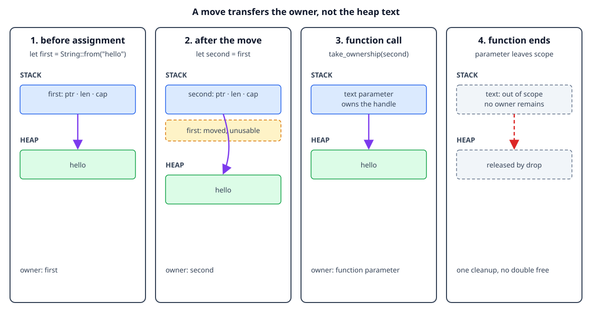

# Move semantics

## By the end, you will be able to

- Predict when assigning a heap-backed value moves ownership.
- Explain why the old variable cannot be used after a move.
- Recognize ownership transfer into and out of functions.
- Read a moved-value compiler error as useful design feedback.

---

## The intuition: one owner, one cleanup

For a heap-backed value such as `String`, the variable contains a small handle
that points to data on the heap. If Rust copied that handle during assignment,
two variables could try to release the same allocation. Rust avoids that
problem by moving ownership: the destination becomes the owner and the source
binding is no longer usable.

```rust
let first = String::from("hello");
let second = first; // ownership moves from `first` to `second`
println!("{second}");
```

The text is not copied by this assignment. The `String` handle and its heap
allocation now belong to `second`. The compiler rejects this because `first` is
no longer an owner:

```rust
// println!("{first}");
```

This is a compile-time rule, so the program cannot accidentally use a moved
value or free its allocation twice.



The diagram is conceptual: it shows ownership and pointers, not literal
addresses or the exact allocator representation.

## Moving into and out of functions

Passing an owned value to a function uses the same rule. The function becomes
the owner for the duration of the call, then drops the value when its parameter
leaves scope:

```rust
fn take_ownership(text: String) {
    println!("inside function: {text}");
} // `text` is dropped here

let message = String::from("hello");
take_ownership(message);
// `message` cannot be used here because ownership moved into the function.
```

If the caller needs the value afterward, the function can return ownership:

```rust
fn give_back(text: String) -> String {
    text
}

let message = give_back(String::from("hello"));
println!("{message}");
```

Returning ownership works, but borrowing is often a better fit when a function
only needs temporary access. The next lessons build on this distinction.

## Complete runnable example

The lesson displays the same source file used by the matching demo:

```rust
--8<-- "examples/02-ownership-and-borrowing/02-move-semantics/main.rs"
```

Run it from the repository root:

```bash
rustc examples/02-ownership-and-borrowing/02-move-semantics/main.rs \
  -o /tmp/rust-move-semantics
/tmp/rust-move-semantics
```

Expected output:

```text
after move: hello
inside function: hello
returned: ownership returned
```

## Exercise: read the compiler message

1. Uncomment `println!("{first}");` after `let second = first`.
2. Compile the program again.
3. Find the line that says `borrow of moved value` or `use of moved value`.
4. Restore the working version, then change `take_ownership` to return the
   `String` and assign the returned value back to a variable.

The compiler error is telling you that the ownership story in the code is
incomplete: decide whether the function should consume the value, return it,
or borrow it.

---

## Checkpoint 1

<div class="quiz" data-answer="b" data-explanation="The destination becomes the unique owner, so the source binding is no longer usable.">
<p>What happens to <code>first</code> after <code>let second = first</code> when the value is a <code>String</code>?</p>
<label><input type="radio" name="move-source" value="a"> It owns a second copy of the heap text</label><br>
<label><input type="radio" name="move-source" value="b"> It is moved from and cannot be used</label><br>
<label><input type="radio" name="move-source" value="c"> It becomes a shared global variable</label><br>
<button class="quiz-check">Check answer</button>
<p class="quiz-result"></p>
</div>

## Checkpoint 2

<div class="quiz" data-answer="c" data-explanation="Passing a String by value transfers ownership to the parameter.">
<p>What does <code>take_ownership(message)</code> do?</p>
<label><input type="radio" name="move-function" value="a"> It always clones <code>message</code></label><br>
<label><input type="radio" name="move-function" value="b"> It only borrows <code>message</code></label><br>
<label><input type="radio" name="move-function" value="c"> It moves ownership into the function</label><br>
<button class="quiz-check">Check answer</button>
<p class="quiz-result"></p>
</div>

## Checkpoint 3

<div class="quiz" data-answer="a" data-explanation="Returning the String transfers ownership back to the caller under a new binding.">
<p>Why can the caller use the result of <code>give_back</code>?</p>
<label><input type="radio" name="move-return" value="a"> The function returns ownership to the caller</label><br>
<label><input type="radio" name="move-return" value="b"> Rust makes every function parameter global</label><br>
<label><input type="radio" name="move-return" value="c"> The heap allocation is never cleaned up</label><br>
<button class="quiz-check">Check answer</button>
<p class="quiz-result"></p>
</div>

## Checkpoint 4

<div class="quiz" data-answer="b" data-explanation="Moving the handle avoids copying the heap allocation and preserves one clear owner.">
<p>Why does Rust move a <code>String</code> instead of silently copying it during assignment?</p>
<label><input type="radio" name="move-reason" value="a"> To make the old variable global</label><br>
<label><input type="radio" name="move-reason" value="b"> To keep one owner responsible for cleanup</label><br>
<label><input type="radio" name="move-reason" value="c"> To prevent all heap allocation</label><br>
<button class="quiz-check">Check answer</button>
<p class="quiz-result"></p>
</div>

---

## Next

Continue with [Copy and Clone](index.md#3-copy-and-clone) to learn why integers
behave differently from `String` during assignment.
