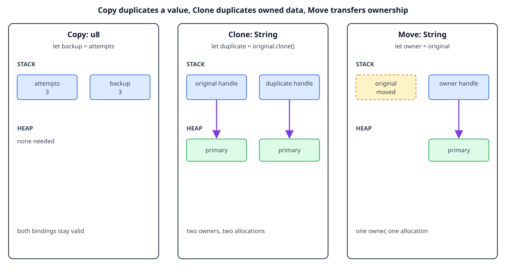

# Copy and Clone

## By the end, you will be able to

- Explain why simple values such as integers can be copied automatically.
- Distinguish an implicit `Copy` from an explicit `clone()`.
- Recognize that cloning heap-backed data can allocate and copy data.
- Use `#[derive(Clone)]` when a type has a meaningful duplication operation.

---

## `Copy`: small values can have two bindings

Some types have a simple, fixed-size representation and no resource that needs
special cleanup. These types can implement `Copy`. Assignment copies the value,
so both bindings remain valid:

```rust
let attempts = 3_u8;
let backup_attempts = attempts; // The number is copied.

println!("{attempts}");
println!("{backup_attempts}");
```

The compiler knows that copying a `u8` does not create two owners of the same
heap allocation. Common `Copy` types include integers, floating-point values,
booleans, characters, and tuples made only from `Copy` types.

## Checkpoint 1

<div class="quiz" data-answer="a" data-explanation="A u8 implements Copy, so assignment creates another usable value instead of moving ownership.">
<p>Why can the code use both <code>attempts</code> and <code>backup_attempts</code>?</p>
<label><input type="radio" name="copy-integer" value="a"> <code>u8</code> implements <code>Copy</code></label><br>
<label><input type="radio" name="copy-integer" value="b"> Rust stores every integer on the heap</label><br>
<label><input type="radio" name="copy-integer" value="c"> The first variable was automatically cloned with a heap allocation</label><br>
<button class="quiz-check">Check answer</button>
<p class="quiz-result"></p>
</div>

## `Clone`: an explicit duplicate

`String` does not implement `Copy` because copying its handle would duplicate
the ownership of one heap allocation. It does implement `Clone`, which makes a
separate copy when you ask for one:

```rust
let original = String::from("primary");
let duplicate = original.clone(); // Explicitly copy the heap text.

println!("original: {original}");
println!("duplicate: {duplicate}");
```

After `clone()`, each `String` owns a different heap allocation. The operation
can be more expensive than a move because it copies the characters and may
allocate memory. That explicit cost is useful: the code shows that two owners
are intentional.



The diagram is conceptual. It shows ownership relationships, not literal
addresses or the exact internal representation of a Rust value.

## Checkpoint 2

<div class="quiz" data-answer="b" data-explanation="clone() explicitly creates an independent String allocation, so both variables can own their text.">
<p>What does <code>original.clone()</code> provide for a <code>String</code>?</p>
<label><input type="radio" name="clone-string" value="a"> A second binding to the same allocation without another owner rule</label><br>
<label><input type="radio" name="clone-string" value="b"> A separate owned copy of the string data</label><br>
<label><input type="radio" name="clone-string" value="c"> A shared reference that lives forever</label><br>
<button class="quiz-check">Check answer</button>
<p class="quiz-result"></p>
</div>

## Clone for structs

A type can derive `Clone` when each of its fields can be cloned. The generated
implementation clones each field, so the `String` field gets its own heap copy:

```rust
#[derive(Clone, Debug)]
struct Settings {
    retries: u8,
    label: String,
}

let settings = Settings {
    retries: 3,
    label: String::from("demo"),
};
let settings_copy = settings.clone();
```

The `u8` field is cheap to copy, while the `String` field performs a heap-data
clone. Deriving `Clone` is convenient, but it should still match the meaning of
duplicating the type in the program.

## Checkpoint 3

<div class="quiz" data-answer="c" data-explanation="A derived Clone implementation clones each field, including the String field's heap data.">
<p>What happens when <code>settings.clone()</code> is called?</p>
<label><input type="radio" name="clone-struct" value="a"> The original settings value is destroyed</label><br>
<label><input type="radio" name="clone-struct" value="b"> Only the retries field is copied</label><br>
<label><input type="radio" name="clone-struct" value="c"> A new Settings value is created with cloned fields</label><br>
<button class="quiz-check">Check answer</button>
<p class="quiz-result"></p>
</div>

## Choose the operation that expresses intent

Use a move when one owner should continue with the value. Use `Copy` when a
small value naturally has independent duplicates. Use `clone()` when two
owners need independent heap-backed data and the copy cost is acceptable. If a
function only needs temporary access, borrowing is often better than either a
move or a clone.

## Checkpoint 4

<div class="quiz" data-answer="b" data-explanation="Cloning a String is explicit because it may allocate and copy heap data; a move only transfers ownership.">
<p>Why is <code>clone()</code> explicit for a heap-backed type?</p>
<label><input type="radio" name="clone-cost" value="a"> Rust cannot move heap-backed values</label><br>
<label><input type="radio" name="clone-cost" value="b"> It may allocate and copy data, so the cost should be visible</label><br>
<label><input type="radio" name="clone-cost" value="c"> It prevents the original value from being dropped</label><br>
<button class="quiz-check">Check answer</button>
<p class="quiz-result"></p>
</div>

## Complete runnable example

The lesson displays the same source file used by the matching demo:

```rust
--8<-- "examples/02-ownership-and-borrowing/03-copy-and-clone/main.rs"
```

Run it from the repository root:

```bash
rustc examples/02-ownership-and-borrowing/03-copy-and-clone/main.rs \
  -o /tmp/rust-copy-clone
/tmp/rust-copy-clone
```

Expected output:

```text
attempts: 3, backup: 3
original: primary, duplicate: primary
settings: Settings { retries: 3, label: "demo" }
settings copy: Settings { retries: 3, label: "demo" }
fields: retries=3, label=demo
```

## Exercise

1. Remove `Clone` from the `Settings` derive and compile the demo. Read the
   compiler error from `settings.clone()`.
2. Replace `original.clone()` with `let duplicate = original;`. Observe which
   binding becomes unusable.
3. Add a `bool` field to `Settings` and clone it again.

---

## Checkpoint 5

<div class="quiz" data-answer="c" data-explanation="The choice depends on intent: Copy for cheap independent values, clone() for an explicit independent heap copy, and move for transferring the single owner.">
<p>Which statement best summarizes the difference between move, Copy, and Clone?</p>
<label><input type="radio" name="copy-clone-summary" value="a"> All three operations make identical heap allocations</label><br>
<label><input type="radio" name="copy-clone-summary" value="b"> Move and Clone are implicit, while Copy must always be called as a method</label><br>
<label><input type="radio" name="copy-clone-summary" value="c"> Move transfers ownership, Copy duplicates simple values implicitly, and Clone explicitly duplicates a value</label><br>
<button class="quiz-check">Check answer</button>
<p class="quiz-result"></p>
</div>

## Next

Continue with [shared borrowing](index.md#4-shared-borrowing) to let functions
read a value without taking ownership or allocating a clone.
