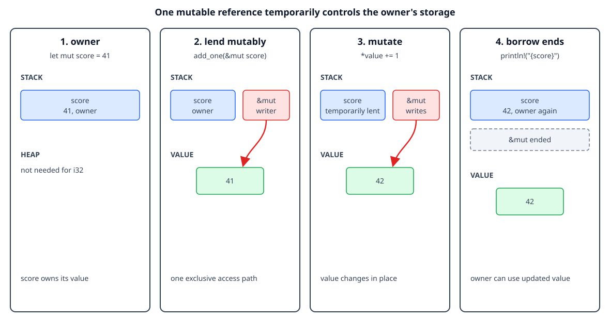

# Mutable borrowing

## By the end, you will be able to

- Create a mutable reference with `&mut T`.
- Change an owner's value through a mutable reference.
- Explain why Rust allows only one active mutable reference.
- Recognize conflicts between shared and mutable references.
- Use short reborrows safely.

---

## Exclusive access without moving ownership

A shared reference `&T` can read a value. A mutable reference `&mut T` can read
and change it, but it gives one borrower exclusive access for its lifetime. The
owner is temporarily lending control, not giving ownership away:

```rust
fn add_one(value: &mut i32) {
    *value += 1; // Dereference, then update the owner's integer.
}

let mut score = 41;
add_one(&mut score);
println!("{score}"); // The owner uses the value after the borrow ends.
```

The binding must be declared `mut` because the value is being changed. The
function parameter is `&mut i32` because the function needs exclusive access to
the caller's integer.



The diagram is conceptual. The mutable reference is shown as temporary
exclusive access to the same storage, not as a second allocation or owner.

## Checkpoint 1

<div class="quiz" data-answer="b" data-explanation="&mut T grants temporary exclusive access, while the original variable remains the owner of the value.">
<p>What does <code>&mut score</code> provide to <code>add_one</code>?</p>
<label><input type="radio" name="mutable-access" value="a"> A new owner that will drop the integer</label><br>
<label><input type="radio" name="mutable-access" value="b"> Temporary exclusive access to change the owner's integer</label><br>
<label><input type="radio" name="mutable-access" value="c"> A read-only copy of the integer</label><br>
<button class="quiz-check">Check answer</button>
<p class="quiz-result"></p>
</div>

## Mutable borrowing with heap-backed data

The same rule works for `String`, `Vec<T>`, and other owned values. A function
can modify the allocation through `&mut` without taking ownership:

```rust
fn add_suffix(text: &mut String) {
    text.push_str("!");
}

let mut message = String::from("Rust");
add_suffix(&mut message);
println!("{message}");
```

`message` still owns the `String` and its heap allocation. The function only
gets a temporary exclusive view, so cleanup remains the owner's responsibility.

## Checkpoint 2

<div class="quiz" data-answer="c" data-explanation="The mutable borrow lets the function change the String, but message remains the owner after the call.">
<p>After <code>add_suffix(&amp;mut message)</code> returns, who owns the String?</p>
<label><input type="radio" name="mutable-owner" value="a"> <code>add_suffix</code> forever owns it</label><br>
<label><input type="radio" name="mutable-owner" value="b"> The mutable reference becomes a second owner</label><br>
<label><input type="radio" name="mutable-owner" value="c"> <code>message</code> remains the owner</label><br>
<button class="quiz-check">Check answer</button>
<p class="quiz-result"></p>
</div>

## Why only one mutable reference?

If two mutable references could exist at once, both could write the same value
without coordination. Rust prevents that data race even in single-threaded
code:

```rust
let mut score = 10;
let first = &mut score;
// let second = &mut score; // Error: cannot borrow `score` as mutable twice.
*first += 1;
```

One mutable reference has exclusive access. Once `first` is no longer used, a
new mutable borrow can begin:

```rust
let mut score = 10;
{
    let first = &mut score;
    *first += 1;
}
let second = &mut score;
*second += 1;
println!("{score}");
```

Rust uses the last use of a reference when it can prove that a borrow has
ended, so the scopes can often be shorter than the surrounding block.

## Checkpoint 3

<div class="quiz" data-answer="a" data-explanation="Two mutable references could write through the same access path at once, so Rust requires one exclusive mutable borrower.">
<p>Why does Rust reject two active <code>&amp;mut</code> references to the same value?</p>
<label><input type="radio" name="mutable-exclusive" value="a"> To prevent conflicting writes through two exclusive access paths</label><br>
<label><input type="radio" name="mutable-exclusive" value="b"> Because mutable references always allocate a second value</label><br>
<label><input type="radio" name="mutable-exclusive" value="c"> Because only integers can be borrowed</label><br>
<button class="quiz-check">Check answer</button>
<p class="quiz-result"></p>
</div>

## Shared and mutable borrows cannot overlap

A shared reference promises that the value will only be read. A mutable
reference promises exclusive access. Those promises conflict, so Rust rejects
this pattern:

```rust
let mut message = String::from("Rust");
let view = &message;
// let edit = &mut message; // Error: shared and mutable borrows overlap.
println!("{view}");
```

End the shared borrow before requesting mutation:

```rust
let mut message = String::from("Rust");
{
    let view = &message;
    println!("before: {view}");
}
let edit = &mut message;
edit.push('!');
println!("after: {message}");
```

This rule prevents a reader from observing a value while another access path is
changing it.

## Checkpoint 4

<div class="quiz" data-answer="b" data-explanation="A shared reader and a mutable writer cannot be active at the same time because the reader could observe a conflicting change.">
<p>Why can <code>&amp;message</code> and <code>&amp;mut message</code> not overlap?</p>
<label><input type="radio" name="mutable-shared" value="a"> Shared references always move the String</label><br>
<label><input type="radio" name="mutable-shared" value="b"> A reader and an exclusive writer would have conflicting access</label><br>
<label><input type="radio" name="mutable-shared" value="c"> Mutable references can only point to stack integers</label><br>
<button class="quiz-check">Check answer</button>
<p class="quiz-result"></p>
</div>

## Reborrowing: a short borrow of a mutable borrow

While holding `&mut T`, you can create a shorter temporary borrow for a call.
The original mutable access becomes usable again after that shorter borrow ends:

```rust
fn show(value: &i32) {
    println!("current: {value}");
}

fn update(value: &mut i32) {
    show(&*value); // Short shared reborrow for this call.
    *value += 1;   // The mutable borrow is usable again.
}
```

The `&*value` expression temporarily views the value through a shared
reference. It does not create another owner, and it does not make the mutable
borrow permanent.

## Complete runnable example

The lesson displays the same source file used by the matching demo:

```rust
--8<-- "examples/02-ownership-and-borrowing/05-mutable-borrowing/main.rs"
```

Run it from the repository root:

```bash
rustc examples/02-ownership-and-borrowing/05-mutable-borrowing/main.rs \
  -o /tmp/rust-mutable-borrowing
/tmp/rust-mutable-borrowing
```

Expected output:

```text
score: 42
message: Rust!
```

## Exercise

1. Change `add_one` to add `10` instead of `1`.
2. Add a function that removes the last character from a `String` through
   `&mut String`.
3. Uncomment both conflicting borrows and read the compiler's explanation.
4. Add a short shared reborrow inside a function that receives `&mut String`.

---

## Checkpoint 5

<div class="quiz" data-answer="c" data-explanation="Mutable borrowing temporarily gives one exclusive access path while ownership and cleanup remain with the original variable.">
<p>Which statement best summarizes mutable borrowing?</p>
<label><input type="radio" name="mutable-summary" value="a"> It transfers ownership and permanently prevents the caller from using the value</label><br>
<label><input type="radio" name="mutable-summary" value="b"> It creates unlimited writers that can update a value together</label><br>
<label><input type="radio" name="mutable-summary" value="c"> It gives one temporary exclusive writer while the owner remains responsible for the value</label><br>
<button class="quiz-check">Check answer</button>
<p class="quiz-result"></p>
</div>

## Next

Continue with [borrowing collections and iterators](index.md#6-borrowing-collections-and-iterators).
