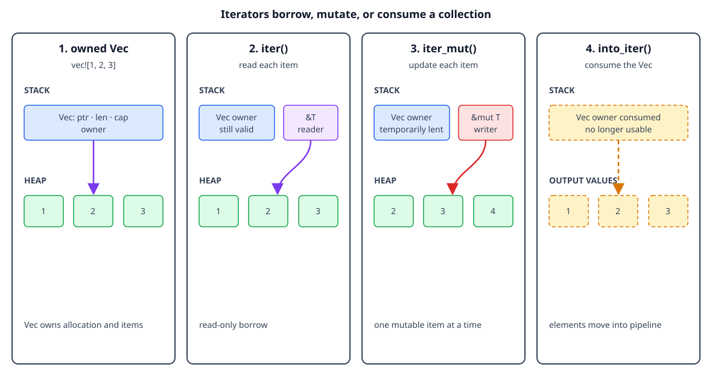

# Borrowing collections and iterators

## By the end, you will be able to

- Describe what a Rust collection owns.
- Borrow collection data with `iter` without consuming the collection.
- Change elements through `iter_mut`.
- Explain why `into_iter` consumes an owned collection.
- Avoid changing a collection while an element is borrowed.

---

## A brief reminder about Rust collections

Collections hold a variable number of values. Common examples are:

- `Vec<T>`: an ordered, growable sequence.
- `String`: growable UTF-8 text.
- `HashMap<K, V>`: key-value associations.

These collections usually keep a small handle on the stack and their elements
in a heap allocation. The collection owns that allocation and its elements, so
Rust needs to know whether an operation is borrowing the elements, changing
them, or consuming the collection.

```rust
let mut numbers = vec![1, 2, 3];
numbers.push(4); // The Vec owns its elements and may grow its allocation.
```

Borrowing lets a function work with the elements while the collection remains
owned by its caller.



The diagram is conceptual. It shows the `Vec` handle, heap elements, and
iterator access paths, not literal addresses or allocator metadata.

## Checkpoint 1

<div class="quiz" data-answer="b" data-explanation="A Vec owns its heap allocation and the elements stored there until ownership is moved or the Vec is dropped.">
<p>What does a <code>Vec&lt;T&gt;</code> own?</p>
<label><input type="radio" name="collection-owner" value="a"> Only the variable name, never its elements</label><br>
<label><input type="radio" name="collection-owner" value="b"> Its collection handle, heap allocation, and elements</label><br>
<label><input type="radio" name="collection-owner" value="c"> A global copy shared by all vectors</label><br>
<button class="quiz-check">Check answer</button>
<p class="quiz-result"></p>
</div>

## `iter`: read elements without consuming the collection

Calling `iter()` creates an iterator that borrows each element as `&T`. The
collection remains available after the loop:

```rust
fn sum_values(values: &[i32]) -> i32 {
    values.iter().sum()
}

let numbers = vec![1, 2, 3];
let total = sum_values(&numbers);
println!("total: {total}");
println!("still owned: {numbers:?}");
```

The function accepts a slice, a borrowed view of the vector's elements. It does
not move the `Vec` and it does not clone the values.

## Checkpoint 2

<div class="quiz" data-answer="a" data-explanation="iter() yields shared references to elements, leaving the original Vec available after iteration.">
<p>What does <code>numbers.iter()</code> yield?</p>
<label><input type="radio" name="iter-borrow" value="a"> Shared references to the elements</label><br>
<label><input type="radio" name="iter-borrow" value="b"> Owned elements after deleting the Vec</label><br>
<label><input type="radio" name="iter-borrow" value="c"> Mutable references that can always resize the Vec</label><br>
<button class="quiz-check">Check answer</button>
<p class="quiz-result"></p>
</div>

## `iter_mut`: change elements in place

When the collection is mutable, `iter_mut()` yields `&mut T` one element at a
time:

```rust
fn add_one_to_each(values: &mut [i32]) {
    for value in values.iter_mut() {
        *value += 1;
    }
}

let mut numbers = vec![1, 2, 3];
add_one_to_each(&mut numbers);
println!("{numbers:?}"); // [2, 3, 4]
```

The iterator provides one mutable element borrow at a time. It does not give
the loop unlimited mutable aliases to the same element.

## Checkpoint 3

<div class="quiz" data-answer="c" data-explanation="iter_mut() yields mutable references, so the loop can update elements without taking ownership of the Vec.">
<p>What is the purpose of <code>iter_mut()</code>?</p>
<label><input type="radio" name="iter-mut-purpose" value="a"> To consume the Vec and return owned elements</label><br>
<label><input type="radio" name="iter-mut-purpose" value="b"> To create a cloned Vec automatically</label><br>
<label><input type="radio" name="iter-mut-purpose" value="c"> To mutate elements through temporary mutable references</label><br>
<button class="quiz-check">Check answer</button>
<p class="quiz-result"></p>
</div>

## `into_iter`: consume and own the elements

`into_iter()` on an owned `Vec<T>` consumes the vector and yields owned `T`
values. After the call, the original vector cannot be used:

```rust
let numbers = vec![1, 2, 3];
let doubled: Vec<i32> = numbers
    .into_iter()
    .map(|value| value * 2)
    .collect();

println!("{doubled:?}");
// println!("{numbers:?}"); // Error: numbers was consumed.
```

This is useful when ownership should move into a new collection or processing
pipeline. It avoids cloning each element, but the source collection is no
longer available.

## Checkpoint 4

<div class="quiz" data-answer="b" data-explanation="into_iter() takes ownership of an owned Vec and yields owned elements, so the original Vec is consumed.">
<p>What happens when <code>numbers.into_iter()</code> is called on an owned <code>Vec</code>?</p>
<label><input type="radio" name="into-iter-consume" value="a"> The Vec is borrowed and remains usable forever</label><br>
<label><input type="radio" name="into-iter-consume" value="b"> The Vec is consumed and its elements are yielded by value</label><br>
<label><input type="radio" name="into-iter-consume" value="c"> Every element is cloned before iteration</label><br>
<button class="quiz-check">Check answer</button>
<p class="quiz-result"></p>
</div>

## Do not mutate while an element is borrowed

A vector may move its heap allocation when it grows. Therefore Rust rejects a
mutation that could invalidate an element reference:

```rust
let mut words = vec![String::from("Rust")];
let first = &words[0];
// words.push(String::from("safe")); // Error: cannot mutably borrow `words`.
println!("{first}");
```

End the element borrow before changing the vector:

```rust
let mut words = vec![String::from("Rust")];
{
    let first = &words[0];
    println!("before: {first}");
}
words.push(String::from("safe"));
println!("after: {words:?}");
```

The compiler protects both ownership and reference validity: no reference may
continue pointing into a collection whose storage has been invalidated.

## Complete runnable example

The lesson displays the same source file used by the matching demo:

```rust
--8<-- "examples/02-ownership-and-borrowing/06-borrowing-collections-and-iterators/main.rs"
```

Run it from the repository root:

```bash
rustc examples/02-ownership-and-borrowing/06-borrowing-collections-and-iterators/main.rs \
  -o /tmp/rust-collection-borrows
/tmp/rust-collection-borrows
```

Expected output:

```text
total: 6
updated: [2, 3, 4]
consumed into new Vec: [4, 6, 8]
```

## Exercise

1. Change `sum_values` to return the largest element instead of the sum.
2. Use `iter_mut()` to multiply each number by `10`.
3. Replace `into_iter()` with `iter()` and explain why the mapping code must
   change.
4. Uncomment the invalid `push` example and read the compiler error.

---

## Checkpoint 5

<div class="quiz" data-answer="c" data-explanation="iter borrows for reading, iter_mut borrows one element mutably at a time, and into_iter consumes an owned collection to yield owned elements.">
<p>Which summary correctly compares the three iterator methods?</p>
<label><input type="radio" name="iterator-summary" value="a"> All three consume the Vec and return cloned elements</label><br>
<label><input type="radio" name="iterator-summary" value="b"> iter mutates, iter clones, and into_iter only reads</label><br>
<label><input type="radio" name="iterator-summary" value="c"> iter reads through borrows, iter_mut changes through mutable borrows, and into_iter consumes</label><br>
<button class="quiz-check">Check answer</button>
<p class="quiz-result"></p>
</div>

## Next

Continue with [slices and API boundaries](index.md#7-slices-and-api-boundaries).
