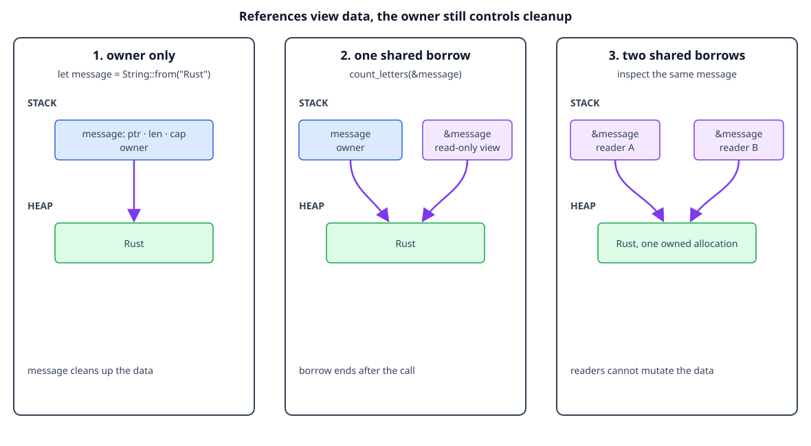

# Shared borrowing

## By the end, you will be able to

- Explain how a reference gives temporary access without transferring ownership.
- Use `&T` and `&str` for read-only function parameters.
- Use multiple shared references at the same time.
- Explain why Rust rejects a reference that could outlive its owner.

---

## Borrow without becoming the owner

Ownership answers “who cleans this value up?” Borrowing answers “who may use it
right now?” A shared borrow, written `&value`, gives read-only access without
creating another owner. The original variable still owns the value:

```rust
fn count_letters(text: &str) -> usize {
    text.len()
}

let message = String::from("Rust");
let count = count_letters(&message); // Borrow, do not move.
println!("{message} has {count} letters");
```

The function receives a reference to the string slice, not the `String` itself.
When the function returns, the borrow ends and `message` remains available to
its owner.



The diagram is conceptual. A reference is shown as a view into owned data, not
as a second owner or a literal memory address.

## Checkpoint 1

<div class="quiz" data-answer="b" data-explanation="A shared reference provides access without transferring cleanup responsibility from the owner.">
<p>What does <code>&message</code> create?</p>
<label><input type="radio" name="borrow-reference" value="a"> A second owner of the String</label><br>
<label><input type="radio" name="borrow-reference" value="b"> A shared reference to the String</label><br>
<label><input type="radio" name="borrow-reference" value="c"> A deep copy of the String</label><br>
<button class="quiz-check">Check answer</button>
<p class="quiz-result"></p>
</div>

## Prefer `&str` for read-only text

The first version could accept `&String`, but `&str` is usually a more flexible
API. A `String` can be viewed as a string slice, and a string literal is already
a string slice:

```rust
fn count_letters(text: &str) -> usize {
    text.len()
}

let owned = String::from("Rust");
let literal = "language";

println!("{}", count_letters(&owned));
println!("{}", count_letters(literal));
```

The function only needs to read text, so it asks for the smallest useful view
instead of requiring one concrete owning type.

## Checkpoint 2

<div class="quiz" data-answer="c" data-explanation="&str accepts a borrowed view of both a String and a string literal, so the API is more flexible.">
<p>Why is <code>&str</code> a good parameter for a read-only text function?</p>
<label><input type="radio" name="borrow-str" value="a"> It takes ownership of every String</label><br>
<label><input type="radio" name="borrow-str" value="b"> It forces callers to allocate a new String</label><br>
<label><input type="radio" name="borrow-str" value="c"> It accepts borrowed text from String values and literals</label><br>
<button class="quiz-check">Check answer</button>
<p class="quiz-result"></p>
</div>

## Multiple shared borrows

Because shared references cannot modify the value, Rust can safely allow more
than one of them at the same time. This is useful when several functions need
to inspect the same data:

```rust
fn first_character(text: &str) -> Option<char> {
    text.chars().next()
}

fn text_length(text: &str) -> usize {
    text.len()
}

let message = String::from("Rust");
let first = first_character(&message);
let length = text_length(&message);
println!("first: {first:?}, length: {length}");
```

Both calls borrow `message`; neither call becomes its owner. Shared borrows are
read-only, so they do not conflict with each other.

## Checkpoint 3

<div class="quiz" data-answer="a" data-explanation="Many shared references are allowed together because they cannot mutate the borrowed value.">
<p>Why can two functions share <code>&message</code> at the same time?</p>
<label><input type="radio" name="borrow-many" value="a"> Shared references are read-only</label><br>
<label><input type="radio" name="borrow-many" value="b"> Each reference becomes the owner</label><br>
<label><input type="radio" name="borrow-many" value="c"> Rust copies the entire String for every reference</label><br>
<button class="quiz-check">Check answer</button>
<p class="quiz-result"></p>
</div>

## Reference lifetime and dangling prevention

A reference must never outlive the value it points to. Rust checks this before
the program runs, so a function cannot return a reference to a local value that
will be dropped when the function ends:

```rust
// This does not compile:
// fn invalid_reference() -> &String {
//     let local = String::from("temporary");
//     &local // `local` is dropped before the caller could use the reference.
// }
```

The safe design is to return ownership:

```rust
fn make_text() -> String {
    String::from("owned result")
}
```

This is the usual choice when the function creates new data: the caller owns
the returned `String` and will clean it up.

### Alternative 1: borrow from the caller

If the data already belongs to the caller, return a reference tied to that
input. The caller keeps the ownership, and the returned reference cannot outlive
the caller's value:

```rust
fn first_word(text: &str) -> &str {
    text.split_whitespace().next().unwrap_or("")
}

let sentence = String::from("Rust is fast");
let word = first_word(&sentence);
println!("{word}"); // `sentence` still owns the characters.
```

The lifetime relationship is expressed by the function signature: the result
is valid only while the borrowed input is valid.

### Alternative 2: return data with a static lifetime

A string literal is stored in the program's binary and is available for the
whole program, so returning `&'static str` is safe:

```rust
fn course_name() -> &'static str {
    "Rust ownership"
}

println!("{}", course_name());
```

This works for fixed data, not for a `String` created inside the function.
Adding `'static` does not extend the lifetime of local variables.

### Alternative 3: return an owned heap value

If the result must be heap-allocated but should have one clear owner, return an
owned value directly. `Box<T>` is useful when the value should be explicitly
owned behind a pointer:

```rust
fn boxed_text() -> Box<String> {
    Box::new(String::from("owned on the heap"))
}

let text = boxed_text();
println!("{text}");
```

The caller owns the `Box<String>`, and Rust drops both the box and its `String`
when `text` leaves scope. In many ordinary cases, returning `String` is simpler
than returning `Box<String>`.

The compiler's rejection prevents a dangling reference from reaching runtime.

| Need | Prefer |
| --- | --- |
| Create new text for the caller | Return `String` |
| Inspect caller-owned text | Return `&str` tied to an input |
| Return fixed program text | Return `&'static str` |
| Explicit ownership behind a pointer | Return `Box<String>` |

## Checkpoint 4

<div class="quiz" data-answer="b" data-explanation="The local String is dropped when the function ends, so returning a reference to it would create a dangling reference.">
<p>Why does <code>invalid_reference</code> fail to compile?</p>
<label><input type="radio" name="borrow-dangle" value="a"> References always need to be mutable</label><br>
<label><input type="radio" name="borrow-dangle" value="b"> The referenced local value would be dropped before the caller used it</label><br>
<label><input type="radio" name="borrow-dangle" value="c"> Returning a String is never allowed</label><br>
<button class="quiz-check">Check answer</button>
<p class="quiz-result"></p>
</div>

## Complete runnable example

The lesson displays the same source file used by the matching demo:

```rust
--8<-- "examples/02-ownership-and-borrowing/main.rs"
```

Run it from the repository root:

```bash
rustc examples/02-ownership-and-borrowing/main.rs -o /tmp/rust-ownership
/tmp/rust-ownership
```

Expected output:

```text
Rust has 4 letters
The owner can still use: Rust
```

## Exercise

1. Change `count_letters` to accept `&String`, then explain why the `&str`
   version accepts more kinds of text.
2. Add a second shared-borrowing function that prints the first character.
3. Uncomment `invalid_reference`, compile it, and read the lifetime error.

---

## Checkpoint 5

<div class="quiz" data-answer="c" data-explanation="Shared borrowing gives temporary read-only access while the original owner keeps cleanup responsibility and the compiler checks the reference lifetime.">
<p>Which statement best summarizes shared borrowing?</p>
<label><input type="radio" name="borrow-summary" value="a"> It permanently transfers ownership to every reader</label><br>
<label><input type="radio" name="borrow-summary" value="b"> It copies the owned value before every function call</label><br>
<label><input type="radio" name="borrow-summary" value="c"> It gives temporary read-only access while the owner remains responsible for the value</label><br>
<button class="quiz-check">Check answer</button>
<p class="quiz-result"></p>
</div>

## Next

Continue with [mutable borrowing](index.md#5-mutable-borrowing) to learn how
`&mut T` allows controlled changes through a reference.
