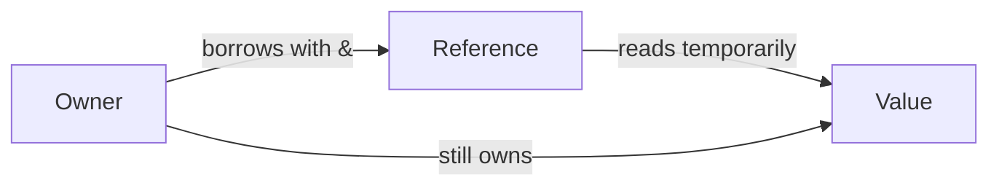

# Ownership and shared borrowing

## By the end, you will be able to

- Explain ownership in one sentence.
- Borrow a value with a reference.
- Recognize why Rust prevents a dangling reference.

---

## The brief version

Ownership is Rust's rule for deciding which variable is responsible for a
value. Every value has one owner. When the owner leaves its scope, Rust cleans
up the value automatically.

Borrowing means using a reference to a value without taking ownership. `&name`
creates a shared borrow, so a function can read a value while the caller keeps
owning it. Rust checks that references never outlive the value they refer to.



---

## Try it

```rust
fn count_letters(text: &String) -> usize {
    text.len()
}

fn main() {
    let message = String::from("Rust");
    println!("{} has {} letters", message, count_letters(&message));
    println!("The owner can still use: {message}");
}
```

The function borrows `message`, so ownership stays in `main`. Compile and run
the complete example from the repository root:

```bash
rustc examples/02-ownership-and-borrowing/main.rs -o /tmp/rust-ownership
/tmp/rust-ownership
```

Expected output:

```text
Rust has 4 letters
The owner can still use: Rust
```

## Exercise

Change `count_letters` to accept `&str` instead of `&String`. The call in
`main` still works, and the function can now accept both string literals and
`String` values.

---

## Checkpoint 1

<div class="quiz" data-answer="b">
<p>Who is responsible for cleaning up a value?</p>
<label><input type="radio" name="ownership-owner" value="a"> Every reference</label><br>
<label><input type="radio" name="ownership-owner" value="b"> The value's owner</label><br>
<label><input type="radio" name="ownership-owner" value="c"> The compiler at random</label><br>
<button class="quiz-check">Check answer</button>
<p class="quiz-result"></p>
</div>

## Checkpoint 2

<div class="quiz" data-answer="a">
<p>What does `&message` create?</p>
<label><input type="radio" name="ownership-borrow" value="a"> A shared borrow</label><br>
<label><input type="radio" name="ownership-borrow" value="b"> A second owner</label><br>
<label><input type="radio" name="ownership-borrow" value="c"> A copy of the string</label><br>
<button class="quiz-check">Check answer</button>
<p class="quiz-result"></p>
</div>

## Next

Continue with mutable borrowing and the rule that a value may have either one
mutable reference or many shared references at a time.
