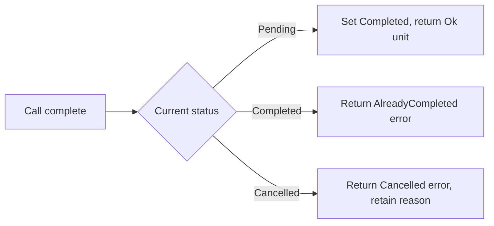

# Topic 6: Result: representing operation outcomes

By the end, you will be able to

- Represent outcomes with **[Result, Ok, and Err](#ok-and-err)**.
- Use **[unit ()](#ok-and-err)** and a **[TaskError](#ok-and-err)** enum.
- Implement a **[checked completion method](#a-checked-completion-method)** and **[handle both outcomes](#handle-both-outcomes)**.

Prerequisite: [Topic 5: Option](05-option.md).
The snippets below build on the previous task model; the complete demo includes
all required definitions.

---

## Ok and Err

Absence and failure answer different questions. Looking for a task may return
no match; trying to complete an already completed task is a rejected operation.
`Result<T, E>` stores either `Ok(T)` for success or `Err(E)` for failure.

```rust
#[derive(Debug, PartialEq)]
enum TaskError {
    AlreadyCompleted,
    Cancelled,
}
```

`Debug` supports inspection; `PartialEq` enables equality assertions. Module 4
explains those traits. Here `T` is `()` because completion has no additional
success value; `E` is `TaskError`, which identifies why it was rejected.

- **`()`** — unit value/type: `Ok(())` reports success without a separate payload.
- **`<>`** — type-argument delimiters: `Result<(), TaskError>` names its success and error types.
<div class="quiz" data-answer="b" data-explanation="Unit is the success value when the effect is the changed task rather than a returned payload.">
<p>What does <code>Ok(())</code> mean for completion?</p>
<label><input type="radio" name="m3-t6-q1" value="a"> The task was not found</label><br>
<label><input type="radio" name="m3-t6-q1" value="b"> Completion succeeded without returning an extra value</label><br>
<label><input type="radio" name="m3-t6-q1" value="c"> An empty error occurred</label><br>
<button class="quiz-check">Check answer</button>
<p class="quiz-result" aria-live="polite"></p>
</div>

---

## A checked completion method

The method borrows the task mutably because it may change its status. It only
changes Pending to Completed; repeated or cancelled completion returns an error
and leaves the original status intact.

```rust
impl Task {
    fn complete(&mut self) -> Result<(), TaskError> {
        match &self.status {
            TaskStatus::Pending => {
                self.status = TaskStatus::Completed;
                Ok(())
            }
            TaskStatus::Completed => Err(TaskError::AlreadyCompleted),
            TaskStatus::Cancelled { .. } => Err(TaskError::Cancelled),
        }
    }
}
```

This replaces Topic 3's unconditional completion method. A cancelled task keeps
its reason; the method neither moves that text out nor discards it.


<div class="quiz" data-answer="c" data-explanation="An unsuccessful transition preserves the existing state and reports its reason through Err.">
<p>What should happen to a cancelled task when completion is rejected?</p>
<label><input type="radio" name="m3-t6-q2" value="a"> Its reason is deleted</label><br>
<label><input type="radio" name="m3-t6-q2" value="b"> It becomes Pending</label><br>
<label><input type="radio" name="m3-t6-q2" value="c"> Its cancelled status and reason stay unchanged</label><br>
<button class="quiz-check">Check answer</button>
<p class="quiz-result" aria-live="polite"></p>
</div>

---

## Handle both outcomes

```rust
match task.complete() {
    Ok(()) => println!("Completed"),
    Err(error) => println!("Cannot complete: {error:?}"),
}
```

The method decides the domain outcome; the caller decides how to report it.
Use `Option` for a missing lookup result and `Result` for a rejected operation.
The error is an ordinary enum value, so it can be matched and tested without
crashing. Propagation with `?` and broader error handling come in Module 5.

---

## Complete runnable example

```rust
--8<-- "examples/03-structs-enums-and-data-modeling/06-result/main.rs"
```

Run from the repository root:

```bash
rustc examples/03-structs-enums-and-data-modeling/06-result/main.rs -o /tmp/rust-06-result
/tmp/rust-06-result
rustfmt --check examples/03-structs-enums-and-data-modeling/06-result/main.rs
```

Expected program output:

```text
completed task 7: Read Rust
second completion: AlreadyCompleted
```

---

## Exercise

1. Match both results of calling `complete` twice and print a friendly message
   for `AlreadyCompleted` instead of debug output.
2. Construct a cancelled task, attempt completion, and assert that its reason
   remains unchanged.
3. Explain why changing the method to return `Option<()>` would lose the
   distinction between an already completed and a cancelled task.

---

## Check your understanding
<div class="quiz" data-answer="a" data-explanation="Option expresses absence, while Result carries a success value or a specific failure reason.">
<p>Which pair best models a missing lookup and a rejected completion?</p>
<label><input type="radio" name="m3-t6-q3" value="a"> Option for lookup, Result for completion</label><br>
<label><input type="radio" name="m3-t6-q3" value="b"> Result for every absent value, Boolean for every error</label><br>
<label><input type="radio" name="m3-t6-q3" value="c"> Panic for both</label><br>
<button class="quiz-check">Check answer</button>
<p class="quiz-result" aria-live="polite"></p>
</div>

---

## Next

Continue with [Topic 7: Putting the task model together](07-task-model.md). Return to the [module index](index.md).
